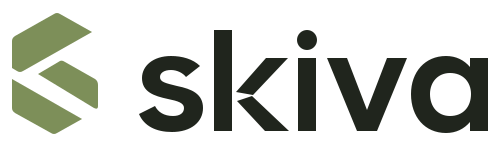

<p align="center">
  <picture>
    <source media="(prefers-color-scheme: dark)" srcset="apps/web/public/brand/skiva-dark.svg">
    
  </picture>
</p>

<p align="center">Git-backed Skills management, releases, and delivery for Agents</p>

<p align="center">
  English · <a href="README.zh-CN.md">简体中文</a>
</p>

<p align="center">
  <a href="https://linghechen.github.io/skiva/">Documentation</a> ·
  <a href="https://linghechen.github.io/skiva/docs/quickstart/">Quickstart</a> ·
  <a href="docs/OPERATIONS.md">Deployment guide</a> ·
  <a href="LICENSE">Apache 2.0</a>
</p>

## What is Skiva?

Skiva helps teams validate Skills stored in Git, compose immutable snapshots, and deliver them to Agents through release channels. Connect an external Git repository or host repositories in Skiva, with self-hosted deployment for internal teams.

Use the console to browse source and version differences, configure validation, review releases, and roll back updates. Agents consume authorized Skills through a read-only Linux filesystem mount.

## Capabilities

| Capability | Details |
| --- | --- |
| Git repositories | External synchronization, webhooks, periodic reconciliation, and native HTTPS Git hosting |
| Validation pipelines | Fixed-commit builds with content, reference, path, and secret checks; repository scripts are not executed |
| Versions and releases | File browsing and diffs, release previews, immutable snapshots, Canary / Stable channels, and rollback |
| Agent delivery | Profile authorization, dynamic or pinned versions, Linux FUSE mounts, and offline cache policies |
| Permissions and audit | Member roles, repository permissions, client credential rotation/revocation, and release auditing |
| Operations | OpenAPI, Prometheus, OTLP, backup/restore, integrity checks, and deployment templates |

## How a release works

1. **Connect a source.** Connect external Git or create a hosted repository and push your Skills.
2. **Build versions.** A pipeline reads a fixed commit, discovers Skills, validates content, and stores artifacts.
3. **Compose a snapshot.** Select Skill versions, preview changes, and create an immutable snapshot.
4. **Promote a channel.** Validate on Canary, then promote Stable. Roll back to a historical snapshot when needed.
5. **Deliver to Agents.** A Profile specifies the channel, authorized Skills, and update mode; clients read that authorized view.

Git pushes update source and trigger builds; they do not automatically promote Stable. See [Your first release](https://linghechen.github.io/skiva/docs/quickstart/) and [Publishing and rollback](https://linghechen.github.io/skiva/docs/releases/).

## Run with Docker Compose

For a local self-hosted evaluation, use the root Compose stack. It builds images, migrates the database, and persists data automatically.

```bash
./scripts/setup-compose.sh
docker compose up --build -d --wait
```

Open <http://localhost:3000>; use `admin@localhost` and the password generated in `.env`. See [Compose setup and upgrades](deployments/COMPOSE.md). This HTTP stack is local-only; HTTPS/OIDC and hosted Git use the [preproduction template](deployments/preproduction/README.md).

## Run locally

Install Go with automatic toolchain support, Node.js 24, Docker, Git, and Python 3. The Makefile selects Go 1.26.10. Start Docker before continuing.

```bash
git clone https://github.com/LingHeChen/skiva.git
cd skiva
cp .env.example .env.local
```

Edit `.env.local` and set `SKIVA_ADMIN_PASSWORD` to a unique password of at least 14 characters, then run:

```bash
make deps
make dev
```

| Service | Default address |
| --- | --- |
| Console | <http://localhost:3000> |
| Documentation | <http://localhost:3000/docs> |
| Backend API | <http://localhost:8080> |
| PostgreSQL | `localhost:55432` |

The default development administrator is `admin@localhost`; its password comes from `.env.local`. To change the console port, set both `SKIVA_WEB_PORT` and `SKIVA_WEB_ORIGIN`.

Local password sign-in is for development. Production requires OIDC, TLS, persistent storage, and backups. See [Operations](docs/OPERATIONS.md) and the [single-host preproduction template](deployments/preproduction/README.md).

## Enable Git hosting

Native Git hosting is disabled by default. After database migration, enable capabilities gradually as appropriate for your deployment:

```dotenv
SKIVA_MANAGED_GIT_ENABLED=true
SKIVA_MANAGED_GIT_WRITE_ENABLED=true
SKIVA_MANAGED_GIT_AUTO_CI_ENABLED=true
SKIVA_GIT_PUBLIC_URL=https://skills.example.internal
```

Create a hosted repository and issue a repository-scoped Git Token in the console. Use standard Git HTTPS clone, fetch, and push. Route `/git/` directly to the Go service at your reverse proxy.

See [Hosted Git](docs/hosting/managed-git.md) for configuration, permissions, and backup requirements.

## Connect an Agent

The Linux client mounts authorized Skills as a read-only directory. A Profile determines the channel, allowed Skills, and update mode:

- `dynamic`: follows channel updates.
- `pinned`: fixes a snapshot; explicitly rebind between tasks.

Build with `make build-mount`. Linux amd64 and arm64 binaries are written to `bin/`. Mounting requires Linux FUSE; each mount needs a separate cache directory.

See [Agent integration](docs/AGENT_INTEGRATION.md) and the runnable [Pydantic AI example](examples/pydantic-agent/README.md).

## Development and verification

```bash
make test-db                       # Create and migrate an isolated test database
make lint test build               # Static checks, tests, and builds
make openapi-generate sqlc-generate # Generate API and database code
make test-e2e                      # Start API and Web first
```

`make test` uses `TEST_DATABASE_URL`; direct Go test runs use `SKIVA_TEST_DATABASE_URL`. Integration tests write data: use a dedicated test database.

Create a local Git demo source with `python3 scripts/demo-source.py`, follow its HTTPS certificate and allowlist instructions, then use `scripts/seed-demo.py` to seed scenarios. See [Acceptance](docs/ACCEPTANCE.md) for verified coverage and deployment boundaries.

## Documentation and project structure

Read the [online handbook](https://linghechen.github.io/skiva/). The console defaults to English and offers a persistent language switch. Documentation has separate [English](https://linghechen.github.io/skiva/docs/) and [Chinese](https://linghechen.github.io/skiva/docs/zh/) routes, with links between equivalent pages.

| Directory | Contents |
| --- | --- |
| `apps/server` | Go API, Git hosting, builds, and distribution |
| `apps/web` | Next.js console and documentation site |
| `apps/mount` | Linux FUSE client |
| `packages` | OpenAPI, distribution protocol, and schemas |
| `migrations` | Database migrations |
| `deployments` | Containers, deployment, and monitoring configuration |
| `examples` | Agent integration examples |
| `docs` | Operations, integration, and acceptance guides |
| `tests` | Browser and static-site tests |
| `scripts` | Development, build, backup, and verification tools |

Documentation content lives in `apps/web/content/docs.en.json` and `docs.zh.json`. Run `npm run build:docs --prefix apps/web` to export to `.pages-build/out`. Documentation changes pushed to `main` are published to GitHub Pages by GitHub Actions. See [Localization](docs/LOCALIZATION.md) for translation maintenance.

## License

Skiva uses the [Apache License 2.0](LICENSE), which permits commercial use, modification, and distribution. See the [license FAQ](LICENSE-FAQ.md), [NOTICE](NOTICE), and [third-party notices](THIRD_PARTY_NOTICES.md) for applicable requirements.
