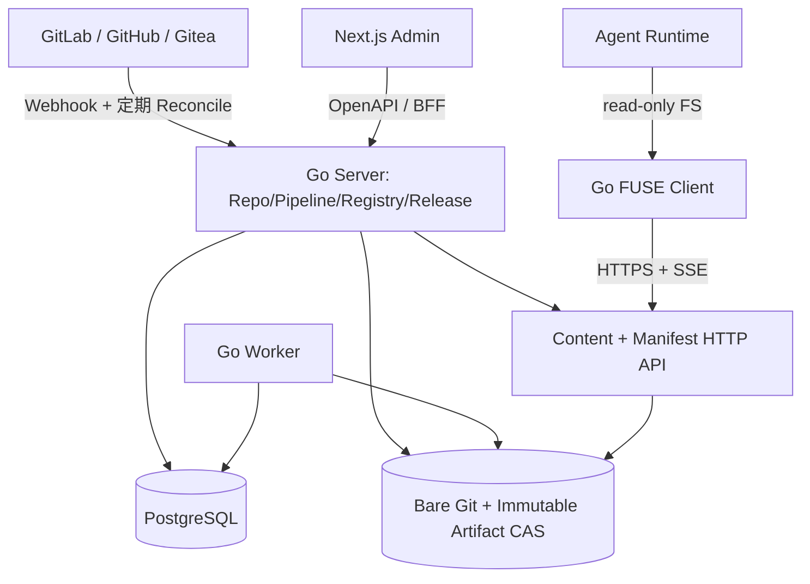

# 02 · 总体架构与 ADR

## 1. 分层

- 控制平面：仓库、CI、审核、发布、权限与审计。
- 数据平面：Profile Manifest、快照文件树、CAS Blob、客户端缓存。
- 客户端：只读 FS 的路径与版本解析、权限凭据、网络重试、本地缓存。

## 2. 选型与职责
Next.js App Router + TS + shadcn/ui + Tailwind；TanStack Query 管理交互数据、React Hook Form + Zod 表单。Go（Chi、pgx、sqlc、goose）管理 API/Worker/Distribution。PostgreSQL 唯一强制中间件。开发/单机部署 Git bare 存储在持久卷，可独立迁移为 S3 CAS，不把 Git Repo 作为高频分发接口。FUSE Linux 首发；后续 WinFsp/macFUSE 做兼容验证。

## 3. 部署拓扑
第一阶段：反向代理/TLS -> Next.js + Go Server（内置 Worker） -> PostgreSQL、持久化 Git/Artifact Volume。客户端经 TLS 直连 Go Distribution（可由同域反代，不经 Next.js 代理 Blob）。

扩展：剥离 Worker 和 Content Service 进程，事件总线可选 Redis Streams/NATS，Blob 进 S3；保持 API/Manifest 契约不变。针对多人企业部署，默认一实例 Worker Leader；抢占任务用 PostgreSQL `FOR UPDATE SKIP LOCKED` + lease + 重试。

## 4. 核心路径
- Git Webhook 验签后只入队并快速 2xx；Fetch 到固定 commit → Sandbox 扫描 → 构建 CAS → 数据库事务写成功状态。
- 发布时对用户选择的具体 `skill_version_id` 集合构建快照清单，进行冲突检查，写不可变快照，原子变更 Channel 指针与审计记录。
- 客户端获取 Profile 的 Manifest（携带 snapshot_id + generation），验证 digest，再按需要下载 Blob。推送仅用于告知“有更新”，以重新拉 Manifest 为真相来源。

## 5. ADR
- ADR-001: **统一 Go 后端**，避免维护双业务中心；Next.js 仅 UI 与窄 BFF。
- ADR-002: **原生 Git CLI**：以有限的、安全的参数集 `exec.Command` 调用；限制 clone/fetch 网络目标和运行权限；禁止执行未经审查的 hooks。Git SHA 不等于构建发布权限。
- ADR-003: **不可变 CAS**：路径名与内容摘要分离，简化缓存、回滚与审计。
- ADR-004: **发布指针事务切换**：数据面按 snapshot_id 读取，客户端对发布代号做乐观同步。
- ADR-005: **默认只读 VFS**：不实现 POSIX 写语义；避免把通用分布式文件系统复杂度带入系统。
- ADR-006: **双一致性模型**：dynamic 允许更新提示后的新 `open` 看到新内容；pinned 固定版本；不能将 dynamic 描述为会话强一致。
- ADR-007: **API 版本化**：`/api/v1` 管理、`/distribution/v1` 文件协议独立升级。
- ADR-008: **多租户保留字段，首发单组织**：企业内网可控，避免多租户共享系统泄露。

## 6. 可扩展与工程原则
- Git Source/Release Snapshot/Agent Profile 分离，允许一个 Skill 为多个 Profile 使用。
- 消除分布式事务：DB 发布快照引用前先确保 CAS 对象持久且验证；失败的孤儿对象可 GC。
- 生成 Manifest 不能返回不存在的 Blob，部署前巡检和发布前二次抽验。
- 构建以 `(repo_id, commit_sha, config_digest, validator_version)` 为幂等键，避免因规则升级错误复用旧通过结果。
- 关键度量：API 延迟、Manifest 失败、Blob 404、Git fetch 耗时、构建失败率、客户端 lag、缓存命中、审计失败、发布回滚次数。
